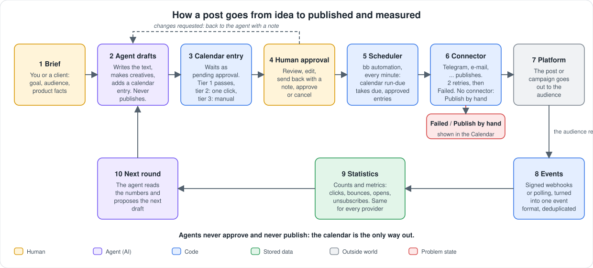
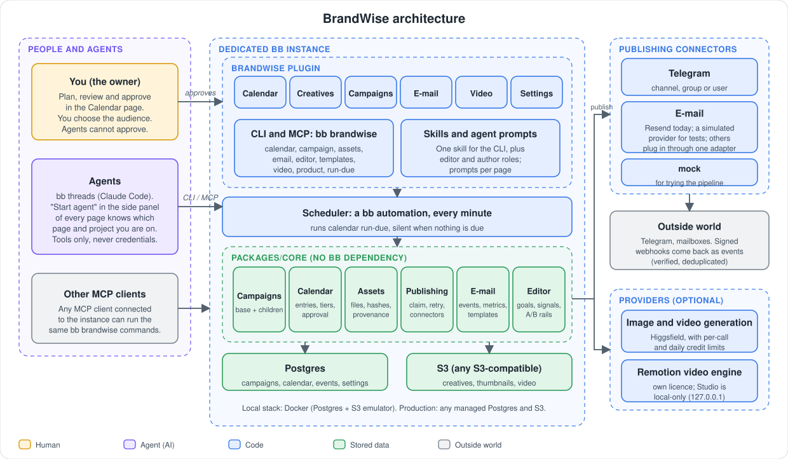
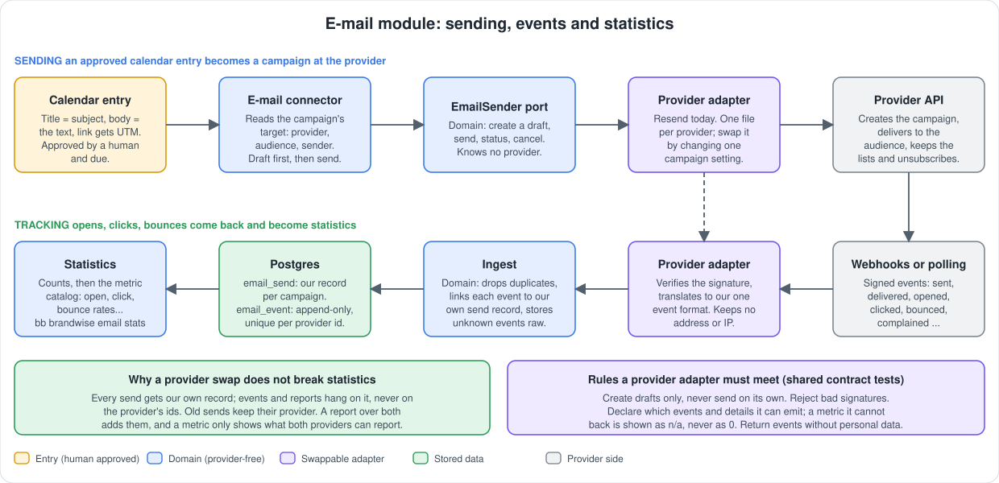

# BrandWise

An open-source, agent-driven marketing system that runs on [bb](https://getbb.app). AI agents plan, write and prepare campaigns; **nothing leaves the system without passing the calendar and a human approval**.

> **Status: early.** It works end to end on one machine (calendar, creatives, publishing to Telegram and e-mail via Resend, statistics, Remotion video), but expect rough edges and breaking changes. Not production-hardened.

## The idea

- **The calendar is the only way out.** Agents create and edit calendar entries. They never publish and never approve. A scheduler hands approved entries to connectors when their time comes.
- **Approval tiers.** Tier 1 passes automatically, tier 2 needs one click, tier 3 is a deliberate manual approval. When unsure, the higher tier wins.
- **Agents get tools, not credentials.** Agents use the `bb brandwise` CLI (also reachable over MCP). API keys live in plugin settings and are never shown to them.
- **Swap providers freely.** Statistics hang on our own records, not on a provider's ids, so replacing the e-mail provider does not break reports.

## How it works



## What is in the box

| Area | What it does |
|---|---|
| Campaigns | An always-on base (brand or product) plus time-bound campaigns that inherit from it |
| Calendar | Month and week views, approval queue, change requests, retries and failure reasons |
| Creatives | Library of images and videos in S3, thumbnails, AI provenance, upload and CRUD |
| Publishing | `calendar run-due` fires every minute (a bb automation); connectors for **Telegram**, **e-mail (Resend)** and a `mock` test connector; channels without a connector wait as "Publish by hand" |
| E-mail | Provider-neutral domain: events, counts and a metric catalog (opens, clicks, bounces, rates), adapters, webhook ingest, `email stats` |
| Generation | Higgsfield image and video generation with per-call and daily credit limits |
| Video (optional) | Remotion projects per campaign, Remotion Studio embedded next to an agent chat, renders land in Creatives |
| Agents | "Start agent" in the side panel of every page; the agent knows which page and project you are on |

## Architecture



In short:

```
agents / MCP ──► bb brandwise CLI ──► plugin ──► packages/core ──► Postgres + S3
                                        │
 bb automation (every minute) ──► calendar run-due ──► connectors ──► Telegram, e-mail, ...
```

- `apps/bb-plugin-brandwise`: the bb plugin (UI pages, CLI, RPC, skills).
- `packages/core`: campaigns, calendar, assets, publishing and the e-mail module on Postgres and S3. No bb dependency.
- `packages/video-remotion`: the optional Remotion engine.
- `infra`: local Postgres and an S3 emulator (Docker), and provisioning of a dedicated bb instance.
- `docs`: design notes, see [`docs/roadmap.md`](docs/roadmap.md) and [`docs/email.md`](docs/email.md).

## Quick start (local)

Requirements: Node 24, Docker, [bb](https://getbb.app) 0.48 or newer, `rsync`.

```bash
cp .env.example .env            # local defaults work as they are
npm run infra:up                # Postgres and an S3 emulator
infra/bb-instance/provision.sh up
```

This starts a dedicated bb instance on port 38896 (your own bb stays untouched), builds and installs the plugin, applies the database migrations and creates the scheduler automation. Open <http://127.0.0.1:38896>, then:

```bash
export BB_SERVER_URL=http://127.0.0.1:38896 BB_HOST_DAEMON_PORT=38897
bb brandwise campaign list                                   # "Main brand" is created on first start
bb brandwise calendar add "Hello" --channel mock --tier 1 --at <ISO time a few minutes ahead>
bb brandwise calendar list                                   # within a minute the scheduler marks it published
```

`mock` publishes to nowhere and is only for trying the pipeline. Tier 2 and 3 entries wait for your approval in the Calendar page.

Optional channels switch on when their credentials are in `.env` (see `.env.example`): `TELEGRAM_BOT_TOKEN`, `RESEND_API_KEY` and `RESEND_WEBHOOK_SECRET`. Where a campaign publishes (a Telegram chat, an e-mail audience) is set per campaign: `bb brandwise campaign channel set ...`.

Details for operating the instance: [`.claude/skills/bb-instance/SKILL.md`](.claude/skills/bb-instance/SKILL.md).

## Extending

- **New channel:** a connector is one small module with `publish(entry)`; see `packages/core/src/publish.ts` and `connector-telegram.ts`.
- **New e-mail provider:** one adapter file that implements the sender and event-source ports, and passes the shared contract tests. See [`docs/email.md`](docs/email.md).



- **New generation provider:** `packages/core/src/providers`.

## Licences and responsible use

BrandWise is MIT licensed (see [LICENSE](LICENSE)). Third-party pieces have their own terms:

- **Remotion** (`packages/video-remotion`) is *not* open source. It is free for individuals and companies of up to three people; larger companies need a [Remotion company licence](https://www.remotion.dev/license). H.264 output is not covered by Remotion's patent licence. The package is separate and optional.
- `tools/video-dl.sh` wraps yt-dlp. Download only content you have the right to use and respect each platform's terms.
- Check the terms of every service you connect (Resend, Telegram, Higgsfield, ...). Marketing e-mail needs recipient consent and a working unsubscribe; AI-generated claims in regulated areas (finance, health) must be reviewed by a human.

## Contributing

Everything in the repository is written in English. Issues and pull requests are welcome, see [CONTRIBUTING.md](CONTRIBUTING.md). Report security problems privately, see [SECURITY.md](SECURITY.md). Everyone taking part follows the [Code of Conduct](CODE_OF_CONDUCT.md).
