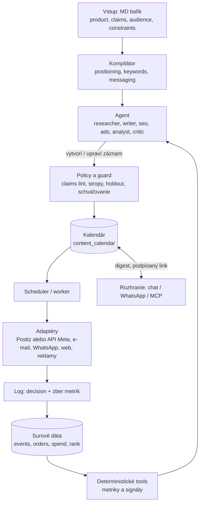

# Architektúra brandwise

Zhrnutie vrstiev z briefu BrandWise + kalendár ako jediná cesta k exekúcii. Čo ešte chýba a v akom poradí: `roadmap.md`. Podrobnosti o produkte sú v briefe (mimo repa).

## 1. Vrstvy

Agent nikdy nevidí surové dáta a nevolá platformu priamo, len deterministické nástroje a policy vrstvu.

## 2. Kalendár

**Pravidlo:** nič neodíde navonok mimo kalendára. Agent a nástroje len vytvárajú alebo upravujú záznamy. Aj „publikuj teraz" je záznam s časom o pár minút, takže prejde kontrolou tvrdení, schválením a limitmi a zapíše sa do `decision`.

**Čo patrí do kalendára:** príspevky, e-maily a WhatsApp šablóny, postupné vypúšťanie pSEO stránok, pravidelné GEO stránky, zmeny rozpočtu v reklamách a follow-upy.

### Záznam (`content_calendar`)

| Pole | Význam |
|---|---|
| `id`, `campaign_id`, `channel`, `market`, `type`, `payload_ref` | čo, kde, pre koho (kampaň = trvalý základ alebo obdobie, pozri `assets.md`) |
| `scheduled_at` (UTC), `timezone` | čas odpálenia, časové pásmo trhu (AT, CZ, SK, letný čas) |
| `status` | `draft → pending_approval → approved → scheduled → publishing → published` alebo `failed`, `cancelled`; z `pending_approval` sa dá vrátiť autorovi s poznámkou (`changes_requested`), akákoľvek úprava ho pošle znova na schválenie |
| `approval_tier`, `approved_by` | schvaľovacia úroveň 1–3 a kto schválil |
| `claims_lint` | výsledok kontroly tvrdení |
| `experiment_id`, `holdout` | experiment alebo holdout skupina |
| `decision_id` | rozhodnutie agenta, ktoré záznam vytvorilo |
| `idempotency_key`, `external_id`, `attempts`, `error` | bezpečné opakovanie a stopa po zlyhaní |

### Pravidlá behu

1. **Kontrola dvakrát:** pri vložení a tesne pred odpálením (rozpočet, claims alebo schválenie sa mohli zmeniť).
2. **Limity:** frekvencia na kanál a deň, tiché hodiny, kolízie, sezónny index.
3. **Odpálenie:** minútová bb automation spustí `calendar run-due`, ktorý si splatné schválené záznamy zoberie (`FOR UPDATE SKIP LOCKED`), znovu skontroluje limity a schválenie, zavolá konektor s `idempotency_key`, pri chybe opakuje s oneskorením a po vyčerpaní pokusov označí záznam `failed` a upozorní človeka. Schválenie je zmena stavu záznamu v Calendar. Ticho znamená, že sa nič nespustí.
4. **Po publikovaní:** automaticky naplánuje zber metrík (napríklad po 1 hodine, 24 hodinách a 7 dňoch), ktoré kŕmia spätné slučky.
5. **Človek:** vidí kalendár cez podpísaný link a v pondelkovom digeste, môže preložiť alebo zrušiť. Ak neodpovie, nič sa nespustí.

### Postiz a kalendár

Zdroj pravdy o čase je náš kalendár. Postiz je len adaptér: v čase odpálenia voláme jeho API, jeho kalendár dopredu nenapĺňame (dva zdroje pravdy by sa rozchádzali pri úpravách). Licencia Postiz je AGPL-3.0, preto ho nepoužívame ako fork, len cez API alebo MCP.

### Najmenšie riešenie

Tabuľka `content_calendar` v Postgrese ostáva zdrojom pravdy a `run-due` ju len vykonáva. Dlhé toky (kompilácia, zber metrík po 1 h, 24 h a 7 d) sú bb vlákna alebo bb automations nad tým istým stavom.

## 3. Stack (rozhodnuté 2026-10-30: všetko na bb)

| Vrstva | Voľba |
|---|---|
| Agent | bb vlákno (Claude Code), roly ako persony, pozri `roadmap.md` |
| Nástroje | `bb brandwise` CLI a MCP inštancie bb, pozri `agent-tools.md` |
| Plánovanie a opakované úlohy | bb automations (minútový `calendar run-due`, zber metrík, týždenný digest) |
| Dáta a stav | Postgres: kalendár, kampane, assety, limity a spotreba, metriky |
| Súbory (assets) | úložisko cez S3 API: lokálne emulátor z `infra/`, v produkcii R2, S3 alebo B2. Metadáta v Postgrese, pozri `assets.md` |
| Poverenia | bb plugin secrets, agent hodnoty nevidí |
| Upozornenia | bb push notifications a stránka Calendar |
| Vstup zvonku | HTTP trasy pluginu (webhooky, OAuth callbacky) so zápisom udalosti |
