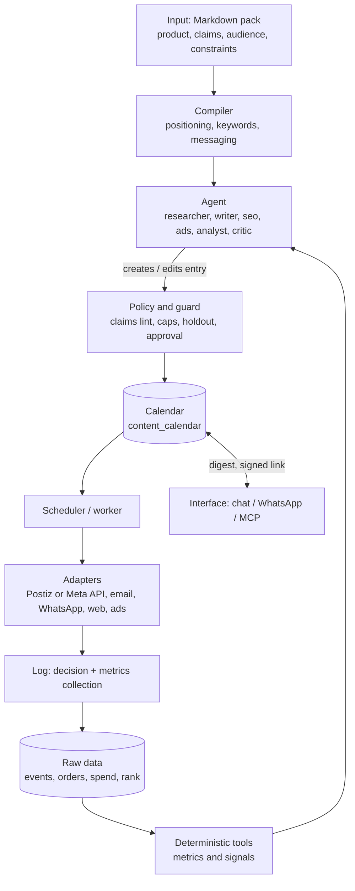

# brandwise architecture

Summary of the layers from the BrandWise brief + the calendar as the only path to execution. What is still missing and in what order: `roadmap.md`. Product details are in the brief (outside the repo).

## 0. At a glance

The diagram below is the longer-term design (compiler, policy layer, research tools); the pictures above show what is built.

## 1. Layers

The agent never sees raw data and never calls the platform directly, only deterministic tools and the policy layer.

## 2. Calendar

**Rule:** nothing goes out except through the calendar. The agent and tools only create or edit entries. Even "publish now" is an entry with a time a few minutes ahead, so it goes through the claims check, approval and limits and is written to `decision`.

**What belongs in the calendar:** posts, emails and WhatsApp templates, gradual release of pSEO pages, regular GEO pages, budget changes in ads and follow-ups.

### Entry (`content_calendar`)

| Field | Meaning |
|---|---|
| `id`, `campaign_id`, `channel`, `market`, `type`, `payload_ref` | what, where, for whom (campaign = always-on base or period, see `assets.md`) |
| `scheduled_at` (UTC), `timezone` | firing time, market time zone (AT, CZ, SK, daylight saving) |
| `status` | `draft → pending_approval → approved → scheduled → publishing → published` or `failed`, `cancelled`; from `pending_approval` it can be returned to the author with a note (`changes_requested`), any edit sends it for approval again |
| `approval_tier`, `approved_by` | approval tier 1–3 and who approved |
| `claims_lint` | result of the claims check |
| `experiment_id`, `holdout` | experiment or holdout group |
| `decision_id` | the agent decision that created the entry |
| `idempotency_key`, `external_id`, `attempts`, `error` | safe retry and a trace of failure |

### Run rules

1. **Check twice:** on insert and right before firing (budget, claims or approval may have changed).
2. **Limits:** frequency per channel and day, quiet hours, collisions, seasonal index.
3. **Firing:** a one-minute bb automation runs `calendar run-due`, which takes the due approved entries (`FOR UPDATE SKIP LOCKED`), re-checks limits and approval, calls the connector with `idempotency_key`, on error retries with a delay and after attempts are exhausted marks the entry `failed` and alerts a human. Approval is a change of the entry's status in Calendar. Silence means nothing is fired.
4. **After publishing:** automatically schedules metrics collection (for example after 1 hour, 24 hours and 7 days), which feeds the feedback loops.
5. **Human:** sees the calendar through a signed link and in the Monday digest, can reschedule or cancel. If they do not respond, nothing is fired.

### Postiz and the calendar

The source of truth for time is our calendar. Postiz is only an adapter: at firing time we call its API, we do not fill its calendar ahead of time (two sources of truth would diverge on edits). Postiz is licensed AGPL-3.0, so we do not use it as a fork, only through the API or MCP.

### Smallest solution

The `content_calendar` table in Postgres stays the source of truth and `run-due` only executes it. Long flows (compilation, metrics collection after 1 h, 24 h and 7 d) are bb threads or bb automations over the same state.

## 3. Stack (decided 2026-10-30: everything on bb)

| Layer | Choice |
|---|---|
| Agent | bb thread (Claude Code), roles as personas, see `roadmap.md` |
| Tools | `bb brandwise` CLI and MCP of the bb instance, see `agent-tools.md` |
| Scheduling and recurring tasks | bb automations (one-minute `calendar run-due`, metrics collection, weekly digest) |
| Data and state | Postgres: calendar, campaigns, assets, limits and spend, metrics |
| Files (assets) | storage via the S3 API: locally the emulator from `infra/`, in production R2, S3 or B2. Metadata in Postgres, see `assets.md` |
| Credentials | bb plugin secrets, the agent does not see the values |
| Notifications | bb push notifications and the Calendar page |
| Inbound | plugin HTTP routes (webhooks, OAuth callbacks) with an event write |
